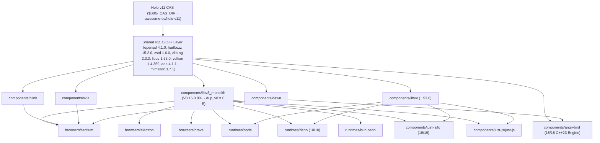

# `awesome-os/chromium-baseline`

> **Unified Chromium `160.0.8184.0` & V8 `16.0.88+` Shared-Library Baseline Monorepo** — Aligning V8, Blink, Skia, Dawn, `libuv`, Sectium, Electron, Brave, Node, Deno, Bun-Neon, `lo`, `just-js`, and **`components/angrybird` (Sovereign 18/18 C++23 Web Engine)** over **Holo `v11` CAS** (`B8G_ABI_MAGIC_V3 = 0x33564742`, **`dup_v8 = 0 B`**).



---

## 1. Unified Baseline Alignment Matrix

### Core Shared Components

| Component | Path | Baseline / Scope | Key Files |
| :--- | :--- | :--- | :--- |
| **Shared V8** | [`components/libv8_monolith/`](components/libv8_monolith/README.md) | V8 `16.0.88+` (`dup_v8 = 0 B` across 8 consumers) | [`holo-v8.mts`](components/libv8_monolith/holo-v8.mts), [`build-libv8.mts`](components/libv8_monolith/build-libv8.mts), [`args.gn`](components/libv8_monolith/args.gn) |
| **Blink** | [`components/blink/`](components/blink/src/index.mts) | Modular Chromium 160 component overlay | [`blink-component-cas.gn`](components/blink/config/blink-component-cas.gn), [`hydrate.mts`](components/blink/src/hydrate.mts), [`blink-cas.test.mts`](components/blink/test/blink-cas.test.mts) |
| **Skia** | [`components/skia/`](components/skia/src/index.mts) | Skia 148 + Graphite + Dawn + Kitty sink | [`skia-cas.gn`](components/skia/config/skia-cas.gn), [`kitty-ascii-sink.mts`](components/skia/src/kitty-ascii-sink.mts), [`skia-cas.test.mts`](components/skia/test/skia-cas.test.mts) |
| **Dawn WebGPU** | [`components/dawn/`](components/dawn/src/index.mts) | Standalone monolithic `libwebgpu_dawn` | [`dawn-cas.cmake`](components/dawn/config/dawn-cas.cmake), [`hydrate.mts`](components/dawn/src/hydrate.mts), [`dawn-cas.test.mts`](components/dawn/test/dawn-cas.test.mts) |
| **libuv** | [`components/libuv/`](components/libuv/README.md) | `1.53.0` + 64-byte `B8G_ARENA_V1` slab pool | [`b8g_libuv.h`](components/libuv/include/b8g_libuv.h), [`b8g_libuv.c`](components/libuv/src/b8g_libuv.c), [`build-zig-cc.mts`](components/libuv/scripts/build-zig-cc.mts) |
| **AngryBird Engine** | [`components/angrybird/`](components/angrybird/README.md) | Sovereign `18/18` C++23/C11 Web Engine | [`b8g_ladybird_bridges.h`](components/angrybird/b8g_ladybird_bridges.h), [`HoloHotLoopJIT.h`](components/angrybird/Libraries/LibJS/JIT/HoloHotLoopJIT.h), [`Simd128.h`](components/angrybird/Libraries/LibWasm/SIMD/Simd128.h), [`WebExtensionsMV3.h`](components/angrybird/Extensions/WebExtensionsMV3.h) |
| **just-js/lo** | [`components/just-js/lo/`](components/just-js/lo/README.md) | `19/19` v11 CAS, `dup_v8 = 0 B` | [`alignment.json`](components/just-js/lo/alignment.json), [`lo_launcher.c`](components/just-js/lo/lo_launcher.c), [`lo-args.gn`](components/just-js/lo/v8-lo-fastcall/lo-args.gn) |
| **just-js/just-js** | [`components/just-js/just-js/`](components/just-js/just-js/README.md) | Shared `libv8_monolith` + `libuv` | [`alignment.json`](components/just-js/just-js/alignment.json), [`just_launcher.c`](components/just-js/just-js/just_launcher.c) |

### Browsers & JavaScript Runtimes (All 8 V8 Consumers Aligned)

| Consumer | Path | V8 `16.0.88+` | `dup_v8` | Primary Entry / Manifest |
| :--- | :--- | :---: | :---: | :--- |
| **Sectium Browser** | [`browsers/sectium/`](browsers/sectium/baseline-manifest.mts) | Shared | `0 B` | [`virtual-frame-shell.mts`](browsers/sectium/shell/virtual-frame-shell.mts), [`release-profile.mts`](browsers/sectium/installer/release-profile.mts) |
| **Electron** | [`browsers/electron/`](browsers/electron/src/index.mts) | Shared | `0 B` | [`hydrate.mts`](browsers/electron/src/hydrate.mts), [`electron-cas.test.mts`](browsers/electron/test/electron-cas.test.mts) |
| **Brave (Shields)** | [`browsers/brave/`](browsers/brave/src/index.mts) | Shared | `0 B` | [`brave_launcher.c`](browsers/brave/src/brave_launcher.c), [`brave-cas.test.mts`](browsers/brave/test/brave-cas.test.mts) |
| **Node.js** | [`runtimes/node/`](runtimes/node/README.md) | Shared | `0 B` | [`alignment.json`](runtimes/node/alignment.json), [`node_launcher.c`](runtimes/node/src/node_launcher.c) |
| **Deno** | [`runtimes/deno/`](runtimes/deno/README.md) | Shared (`10/10`) | `0 B` | [`alignment.json`](runtimes/deno/alignment.json) |
| **Bun-Neon** | [`runtimes/bun-neon/`](runtimes/bun-neon/index.mts) | Shared (`12/12`) | `0 B` | [`alignment.json`](runtimes/bun-neon/alignment.json), [`v11-max-lock.json`](runtimes/bun-neon/v11-max-lock.json), [`bun-neon.test.mts`](runtimes/bun-neon/bun-neon.test.mts) |
| **just-js/lo** | [`components/just-js/lo/`](components/just-js/lo/README.md) | Shared (`19/19`) | `0 B` | [`alignment.json`](components/just-js/lo/alignment.json) |
| **just-js/just-js** | [`components/just-js/just-js/`](components/just-js/just-js/README.md) | Shared | `0 B` | [`alignment.json`](components/just-js/just-js/alignment.json) |

---

## 2. Upstream Tracking & Programmatic Alignment

- **Upstream Lock & Gravity Tracker:** [`upstream/UPSTREAM-LOCK.json`](upstream/UPSTREAM-LOCK.json), [`upstream/chromium-tracker.mts`](upstream/chromium-tracker.mts), [`upstream/semantic-diff.mts`](upstream/semantic-diff.mts), [`upstream/ahead-of-chrome-pins.json`](upstream/ahead-of-chrome-pins.json), [`upstream/max-version-lock.json`](upstream/max-version-lock.json)
- **Alignment Verifier:** [`alignment/chromium-baseline-lock.json`](alignment/chromium-baseline-lock.json), [`alignment/verify-alignment.mts`](alignment/verify-alignment.mts), [`alignment/verify-alignment.test.mts`](alignment/verify-alignment.test.mts)

---

## 3. Verification

```sh
npm test
node alignment/verify-alignment.mts
```
